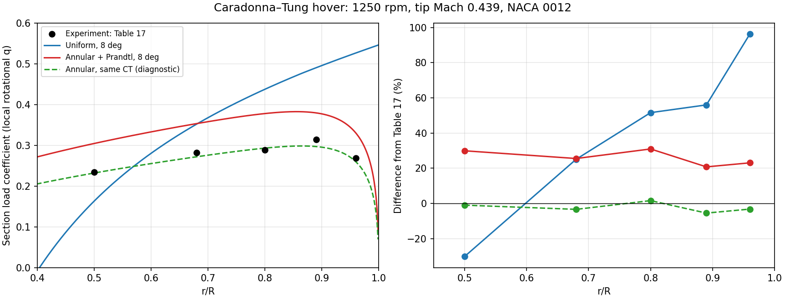

# Caradonna–Tung 悬停径向载荷对照

2026-11-13，RotorDesignLab `0.2.0.dev2`。采用 NASA TM-81232 表 17 的原始表格数值，对照 1250 rpm、总距 8°、叶尖 Mach 0.439 的两片叶旋翼。

## 主要结果

当前径向入流加 Prandtl 尖损失模型在**同总距**条件下高估总拉力 **29.09%**，5 个测站的径向载荷平均绝对百分比误差为 **26.04%**。数值收敛检查通过，当前模型在这个工况的总距—拉力预测仍有明显偏差。

将总距反求到 **6.67072°** 后，总拉力与试验匹配，径向载荷平均绝对百分比误差降至 **2.94%**，最大为 **5.50%**。这是同拉力的分布形状诊断；匹配总拉力使用了试验 CT，需与同总距的独立预测分开评价。

|口径|总距 / °|CT|CT 偏差|径向 MAPE|径向最大绝对偏差|
|---|---:|---:|---:|---:|---:|
|试验|8.00000|0.004600|—|—|—|
|均匀入流|8.00000|0.006417|+39.50%|51.82%|96.23%|
|径向入流 + Prandtl|8.00000|0.005938|+29.09%|26.04%|30.95%|
|径向入流，同 CT 诊断|6.67072|0.004600|小于 1e-8%|2.94%|5.50%|



|r/R|原表 CL|径向模型，同总距|偏差|径向模型，同 CT|偏差|
|---:|---:|---:|---:|---:|---:|
|0.50|0.2345|0.30464|+29.91%|0.23217|−1.00%|
|0.68|0.2815|0.35332|+25.51%|0.27199|−3.38%|
|0.80|0.2886|0.37791|+30.95%|0.29314|+1.57%|
|0.89|0.3143|0.37956|+20.76%|0.29701|−5.50%|
|0.96|0.2683|0.33016|+23.05%|0.25961|−3.24%|

表内保留的位数用于复算，不表示试验精度。原报告表格保留四位小数，半个末位单位为 0.00005；未取得各测站的试验误差条。

## 来源、输入及适用范围

|项目|本次输入|依据和处理|
|---|---|---|
|桨叶数、翼型、扭转|2；NACA 0012；0°|S01 试验说明，矩形无扭转桨|
|半径、弦长|1.143 m；0.1905 m|S01 图 1 的 7.5 ft 直径和正文 R/c=6；与公开复算 S03 表 4.1 核对|
|预锥|0.5°|S01 正文明确给出|
|有效根部|r/R=1/6|沿用 S03 的数值建模取值 0.1905 m；原试验有效根部细图仍缺，检查 0.1/0.243 敏感性|
|工况|1250 rpm；8°；严格零来流|S01 表 17；CT=0.00460 来自图 6 的对应工况|
|声速|340.8163 m/s|由半径、转速和原表 Mtip=0.439 推得|
|密度、动力黏度|1.225 kg/m³；1.7894e-5 Pa·s|标准条件假定；黏度仅用于报告局部 Re，未参与气动表插值|
|翼型气动输入|Re=2.00e6，M=0.15，自由转捩|S02 表 I，保留原 α/CL/CD 数据；表 VII 固定转捩作独立敏感性检查|
|马赫数处理|CL 乘 √(1−0.15²)/√(1−M²)，CD 保持原值|Prandtl–Glauert 工程估计，生成的 Mach 网格明确标为模型值|
|求解器|刚性桨；逐环带动量；Prandtl 尖损失|复用 XV-15 阶段模块，未拟合旋翼试验修正系数|

原报告、录入表、模型化扩展分别登记在 [provenance.json](../validation/caradonna-tung/provenance.json)。S02 网页摘要的 Re 范围较粗，本次以 PDF 表 I 明确标注的 `2.00×10⁶` 为准。

翼型输入保留测得的负攻角点；在更负的攻角处，以正攻角的奇对称 CL、偶对称 CD 延拓，供均匀入流模型内侧叶素使用。径向模型本工况全桨攻角约 **0.78–3.42°**，5 个比较测站均使用原表正攻角范围。收敛后越出输入 α/Mach 范围会报错；本表限制到 M=0.5，未据此计算跨声速旋翼。

5 个测站的估算 Re 约 **0.98–1.88×10⁶**，低于或接近当前统一采用的 2.00e6 翼型表。局部 Re 尚未进入求解器；翼型 Mach 修正也不是完整风洞 Mach/Re 数据库。这两项属于当前输入能力的明确缺项。

## 载荷系数与压力积分核对

原表给出由压力积分得到的 sectional CL。本次从叶素力重建单桨单位展长的旋翼法向系数：

`C_rot(r) = (dT / B dr) / [0.5 ρ (Ωr)² c]`

这里采用局部转速动压，半径使用名义桨叶半径；不把翼型查表的 CL 直接当作旋翼载荷系数。预锥投影已含在 dT 中。`comparison.csv` 同时输出弦线法向系数及相对气流升力系数，并统一换算到相同转速动压。在本次 5 个测站，径向模型不同力方向口径的最大差为 **0.60%**；同 CT 为 **0.56%**。

S01 未完整列出 CL 的积分端点、积分算法和力方向变换步骤，因此保留这一口径缺项。另录入表 17 的 r/R=0.8 全套压力孔数据，按原表 **−Cp** 符号，用分段线性积分、前缘上下表面连续、尾缘 Cp=0 得到弦线法向系数 **0.2868366**，与原表 CL=0.2886 相差 **−0.61%**。该检查确认符号和数量级；不以重新积分值替换作者公布的 CL。

计算误差指标在 5 个实际测站等权统计。先对计算的径向系数线性插值到测站，再计算 RMSE、MAPE 和最大绝对百分比误差。径向模型同总距 RMSE=**0.07230**，同 CT RMSE=**0.00991**。5 点数据不足以独立重建全桨总拉力，CT 对照仍使用作者图 6 的总量。

## 误差检查与模型缺项

480→960 叶素，在保持 8° 总距时，T 变化 **0.00755%**，Q/P 变化 **0.01163%**，5 个测站系数最大变化 **0.00479%**，均低于 0.2% 的离散检查门槛。数值积分误差远小于当前试验差异。

|独立变更，其余输入保持|CT 对试验偏差|径向 MAPE|
|---|---:|---:|
|基准：自由转捩 + PG + Prandtl|+29.09%|26.04%|
|取消 PG，保持 M=0.15 翼型表|+25.48%|22.51%|
|采用同 Re/M 的固定转捩表|+26.72%|23.72%|
|取消尖损失|+40.64%|34.38%|
|预锥改为 0°|+29.10%|26.05%|
|根部改为 0.1R|+29.29%|26.04%|
|根部改为 0.243R|+28.39%|26.04%|

这些是单因素计算，不构成统计置信区间。已检查的输入变动无法消除主要偏差。反求同 CT 后分布较接近，提示应优先查清有效攻角/入流及有限展弦比影响；尚不能从这一个工况唯一归因。

当前环带动量模型缺少非局部尾迹收缩、离散尖涡作用、三维有限展长效应、根损失和桨叶弹性。原作者本身也借助实测尖涡位置和强度改进载荷预测。后续应先补齐覆盖局部 Re/M 的翼型数据和独立低速工况，再用升力线/规定尾迹模型复核径向入流。若引入工程修正，需用独立工况检验，不能把本次总距差直接设为通用修正。

本阶段完成可重复的定量对照，**未达到同总距准确预测该试验的程度**。它与 XV-15 的耗功低估一起，为下一阶段模型改进提供了明确目标。公开算例的物理误差状态保存在 `checks.json` 的 `engineering_accuracy_qualified: false`。

## 复算与检查

项目环境无需新增依赖，从仓库根目录执行：

```powershell
.\.venv\Scripts\python.exe -m rotordesignlab run validation/caradonna-tung/hover.json --out runs/ct-single
.\.venv\Scripts\python.exe -m tools.validate_caradonna --out runs/ct-validation
.\.venv\Scripts\python.exe -m unittest discover -s tests -v
```

输出目录需新建。源 PDF 置于 `runs/public-sources` 后，可用 `python -m tools.prepare_caradonna --out runs/ct-input-check` 按已复核的录入表重建输入；脚本先检查两份 PDF 的 SHA-256。它不是 OCR 自动识别器，录入表的出处、原始数值和模型化扩展均保留在脚本中。

18 项单元测试通过，包括测得翼型节点恢复、由径向系数积分还原 CT、动量残差、P=ΩQ、公开工况快照复算，以及不支持的 Mach 工况拒绝。原始运行目录保留压力核对、网格与敏感性数据；公开仓库保存必要的 CSV、图和输入/代码哈希。本阶段未修改求解器方程或界面。

## 公开来源

- **S01** Caradonna & Tung, 1981, *Experimental and Analytical Studies of a Model Helicopter Rotor in Hover*, NASA TM-81232。[NASA 原文](https://ntrs.nasa.gov/api/citations/19820004169/downloads/19820004169.pdf)。表 17：PDF 第 28 页；图 6：PDF 第 49 页；SHA-256 见 provenance。
- **S02** Ladson, 1988, *Effects of Independent Variation of Mach and Reynolds Numbers on the Low-Speed Aerodynamic Characteristics of the NACA 0012 Airfoil Section*, NASA TM-4074。[NASA 原文](https://ntrs.nasa.gov/api/citations/19880019495/downloads/19880019495.pdf)。表 I：PDF 第 8 页；表 VII：PDF 第 18 页。
- **S03** Ferlisi, 2018, *Rotor Wake Modelling Using the Vortex-Lattice Method*，表 4.1。[大学公开论文](https://publications.polymtl.ca/3059/1/208_CarloFerlisi.pdf)。仅用于公开数值模型的根部取值交叉核对。
