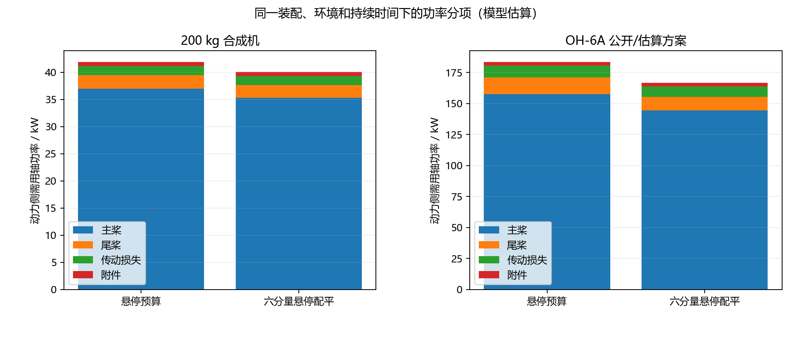

# 悬停预算与六分量配平：功率差异及B包记录

2026-11-18；基线`37333c2 / 0.4.6.dev9`，交付`0.4.6.dev10`。本包回答总体/初步设计中的实际问题：同一装配为何给出不同需用功率和动力裕度，以及差异是否来自错误记账。没有改变原求解模型、气动表、插值缺省、下载策略或既定门槛。

## 同事如何使用

左侧选择“悬停求解”，保持“功率与载荷预算”，在“预算任务”选择**预算—配平功率对照**。设置同一空气环境、高度、需维持时间与网格，点击“运行分析”。程序对当前装配快照分别计算两种方法，显示中文功率对照表及各自假设。可以下载CSV和完整结果包、查看历史结果，并用导出的`case.json`复算。尚未提交的改参不改变历史结果。

单独预算和配平结果也增加“功率分账与模型假设”：主尾桨轴功率、各自传动损失、附件、额定功率与限时，实际入流/尖损失/预锥/挥舞，以及下载力方向和未平衡载荷。对照中只有一种方法成功时，保留成功项和失败原因，不给出比较结论。若本次持续时间功率判定相反，明确显示“功率可行性依赖模型假设”。

## 功率账目

各旋翼采用正驱动扭矩，`P=ΩQ`；机体反扭矩的负号不用于轴功率。动力侧需求为：

`P需用 = P主桨/η主传动 + P尾桨/η尾传动 + P附件`

等价分项为主桨轴功率、尾桨轴功率、两路传动损失`P(1/η−1)`及附件耗功。动力曲线的可用功率与附件均在动力侧，旋翼部件限值在轴端，不能混用。

下载、机身和尾翼是载荷项，其对功率的影响通过旋翼求解体现；不能再把“下载功率”叠加到已算出的轴功率上。姿态平衡所需侧向推力、力矩和周期变距也是如此。本包新增独立账目残差，不替换旧程序的汇总运算顺序。

预算固定机体姿态，仅闭合Fz和Mz，主尾桨按轴流模型求解。六分量配平求滚转/俯仰和四项操纵量，并闭合旋翼内部入流/挥舞。其三状态入流在均匀轴流极限可与轴流均匀模型一致，但一般不等于带Prandtl修正的环带入流。预算的固定预锥与配平的挥舞参数也来自不同显式字段，旧语义保持。

## 两个原方案的复算

冻结几何、旋向、转速、安装、空气环境、额定功率和持续时间。海平面标准环境，80径向站，配平36方位站，持续600 s。合成机200 kg；OH-6A为专家原公开/估算方案1157 kg，沿用原模型，不混入A3的替代惯量假设。

|项目（kW）|合成机预算|合成机配平|OH-6A预算|OH-6A配平|
|---|---:|---:|---:|---:|
|主桨气动轴功率|36.95269|35.33798|157.77163|144.50370|
|尾桨气动轴功率|2.50908|2.34288|13.36908|10.80339|
|主桨传动损失|1.53970|1.47242|8.30377|7.60546|
|尾桨传动损失|0.18886|0.17635|1.00627|0.81316|
|附件耗功|0.70000|0.70000|3.00000|3.00000|
|动力侧需用轴功率|41.89032|40.02963|183.45075|166.72570|
|本次600 s功率余量|3.10968|4.97037|−23.50075|−6.77570|



原OH-6A方案短时额定188.29 kW、限时300 s，连续额定159.95 kW。本次600 s两方法均超连续额定；不能拿短时可用功率判定600 s工况。另按原报告1185.2 kg、180 s输入复跑，预算189.25884 kW、余量−0.96884 kW；配平171.67624 kW、余量+16.61376 kW，成功复现相反功率判定。这里只验证软件和方法差异，不把该载荷/动力输入当作试飞真值；原“0.51%精度”仍未验收。

## 沿固定路径解释差值

保持同一装配参数，另存诊断副本，顺序为：原预算 → 取消尖损失 → 均匀入流预算 → 六分量配平且保留相同3%下载比例 → 原配平（不附加残余比例下载）。每一步重新联立求主尾桨需求。下表为上一步减下一步的功率减少量，完整主尾桨和传动增量见[CSV](../validation/power/attribution.csv)。

|该路径的变化|合成机减少量 kW|OH-6A减少量 kW|
|---|---:|---:|
|取消Prandtl尖损失|0|5.112696|
|环带改为均匀入流|0|4.547755|
|均匀轴流预算改为含相同比例下载的六分量配平|0.067883|0.796895|
|六分量配平取消3%残余比例下载|1.792810|6.267704|
|合计|1.860693|16.725051|

这是指定顺序下的条件分解，存在主尾桨与操纵耦合，换顺序会改变分项。它解释了原报告约10.45 kW的剩余差值：约9.66 kW在该路径上来自尖损失与径向入流变化，约0.80 kW属于其余几何/运动/整机平衡差异；不能全部归为尖损失，更不能据此拟合通用κ或B。

合成机原本就是均匀入流、无附加尖损失，所以前两步为零。两机传动效率和附件从头到尾不变，传动损失差随主尾桨轴功率自然改变，附件差为零，没有发现重复记账。

还核对了以下具体条件：

- 两入口尾桨的有符号偏航推力臂完全相同，合成机−1.7 m、OH-6A −4.6228 m；负号来自机体系右手力矩定义，不是负的几何距离。
- OH-6A预算留下前向613.051 N、侧向673.833 N以及滚转/俯仰剩余力矩。六分量配平通过约−3.261°滚转、+1.862°俯仰和非零周期变距闭合它们，尾桨需求因此不同。合成机配平姿态约−3.169°、−0.0814°。
- OH-6A预算主桨固定预锥1.5°，配平预锥输入0°、解得平均锥度约2.649°，并有一阶挥舞。预算按其投影桨盘面积求轴流；配平使用自身方位角几何和入流口径。这些差异包含在约0.797 kW中，未单独拟合或宣称各自贡献。
- 预算下载沿机体系+Z；六分量历史比例策略沿主桨推力轴反向。OH-6A轴倾3°，即使比例同为3%，力向量也不同。两种历史语义均保留，实际力向量随结果导出。
- 此悬停OH-6A方案的机身/尾翼模型载荷为零；合成机平尾约0.842 N向下。它们各自保留在载荷账目中，不把上述剩余差异笼统称为“机身阻力”。

## 相同条件与验证边界

另外抽取两机主尾桨，共四套几何/翼型，固定零预锥、零铰偏置、零周期变距、相同名义桨盘面积。分别检查三种轴流假设的同总距T/Q/P、同目标拉力反求总距与Q/P；再将均匀入流结果与固定桨叶的方位角/稳态PP入口对照。同总距和同拉力两组T/P最大相对差小于6×10⁻¹²，通过预先采用的1e−6一致性门槛。反求使用原1e−6内部拉力容差，P=ΩQ和传动/附件收支残差通过1e−7 W检查。原同总距与同拉力两类数据均保留在[公开记录](../validation/power/checks.json)。

这些是实现与记账一致性检查。真实尾迹、黏性/非定常、机身下洗等低阶模型误差仍按原范围解释，没有用方法一致替代独立物理验证。HOGE边界没有新增开放；通用开环仍受R19限制。

本账目是**稳态气动轴功率**。现有瞬态模型规定转速，挥舞储能和桨毂传递功率尚未形成完整瞬态能量收支；本包没有把气动ΩQ改称发动机瞬态峰值。相关输出明确标注，瞬态动力验收继续单列，当前回到C包的初步设计方案比较。

## 复算与工作记录

公开冻结输入在`validation/power/inputs/`，包含参数来源和工程估算说明，不需要本地专家包即可复算：

```powershell
python -m rotordesignlab run validation/power/inputs/oh6/case.json --out runs/新的功率对照目录
python -m tools.verify_power_budget --inputs validation/power/inputs --out runs/新的B包核查目录
python -m unittest discover -s tests -p test_power_accounting.py -v
```

过程、保护副本和原始失败日志在`runs/b-power-20261118/`。四组修改前后原预算/配平summary及可行性逐值不变；四项新增测试覆盖账目、额定限时边界、部分失败、分歧和目录搬移复算；自动网页检查覆盖运行、历史重开、实际输入隔离、导出复算及持续时间改变。没有新增真实用户实测。

首次测试构造误删结构必填字段，导致整体读取失败而非预期的单方法失败；另一个测试把高空连续额定设得高于短时额定。已改为合法输入中的配平专用基底错误及一致额定曲线后通过，保留初次日志；没有修改生产校验规则或放宽门槛。

全库130项测试通过（194.35 s）。公开冻结输入独立复算的全部阶段summary、同总距/同拉力旋翼数据逐值一致；输入SHA清单与中文功率图已检查。结果生成时仍标dev9加B包工作区，未回填旧结果版本，dev10标识最终交付。B包稳态解释至此完成；下一工作包为C方案比较，未完成的瞬态功率/物理精度单列保留。
