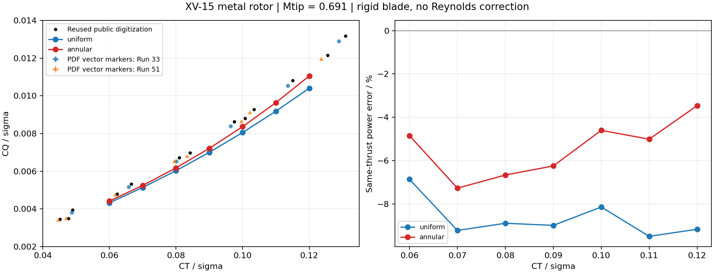

# XV-15 金属桨悬停定量对照

2026-11-13，RotorDesignLab `0.2.0.dev2`。复用既有 Hover_BENCHMARK 的公开基准材料，完成输入核对、接口适配、严格零来流求解和误差分析。

## 结果

在 `CT/σ=0.06–0.12` 的 7 个同拉力工况上，径向入流加 Prandtl 尖损失模型的轴功率相对既有公开数字化参考低估 **3.46%–7.27%**，平均偏差 **−5.44%**。均匀入流模型低估 **6.86%–9.50%**，平均偏差 **−8.68%**。两种口径均保留，未用试验拟合诱导功率系数、效率或升阻力修正。

|CT/σ|径向入流总距 θ75 / °|径向入流 FM|同拉力功率偏差 / %|均匀入流功率偏差 / %|
|---:|---:|---:|---:|---:|
|0.06|6.19071|0.70175|−4.84|−6.86|
|0.07|7.16520|0.74469|−7.27|−9.23|
|0.08|8.10014|0.77272|−6.67|−8.89|
|0.09|9.00977|0.78968|−6.25|−8.99|
|0.10|9.90511|0.79759|−4.60|−8.14|
|0.11|10.79436|0.79824|−5.01|−9.50|
|0.12|11.68667|0.79329|−3.46|−9.17|



这次完成的是规定工况范围内的定量试验曲线对照。数值收敛检查通过，仍有稳定的功率低估；尚未给该模型设定或宣称统一的工程精度等级。

## 复用与来源核对

- 复用既有 NASA 金属桨几何，经列名适配后直接作为产品输入；与本次独立原文提取的弦长、扭转差均为 0。
- 采用同一套 NASA 四组气动表，保留各组 CL/CD 的原始 Mach 网格，避免把重采样后的扩展范围误作原始数据范围。与既有并集网格的逐节点插值最大差为 `4.44×10⁻¹²`，来自原 CSV 保存精度。
- 复用既有 19 点 CT/σ–CQ/σ 和 17 点 CT–FM 公开数字化文件。SHA-256 与此前来源清单一致；它们是公开验证项目提供的二次数字化数据。[S03]
- 复用既有 BEM/CCBlade 三档载荷结果作为方法互校，没有重跑历史 DUST。输入、引用文件及原始哈希见 [复用核对表](../validation/xv15/reuse-audit.json)。
- 独立读取 Betzina 原论文图 15 的 20 个矢量标记，保留 Run 33/51 区分、PDF 坐标、图轴标定和标记编号，用于检查二次数字化参考的影响。[S01]

## 输入与模型

|项目|本次采用|依据或性质|
|---|---|---|
|半径、桨叶数|3.81 m、3|S01 表 1；S02 附录 A|
|有效根部|0.1R|S02 `REDGE` 工程模型|
|弦长、扭转|NASA 金属桨工程分布；θ75 定义总距|S02 原始 51 个结构扭转站位，参考站扭转为 0°|
|展向气动站位|0.20、0.55、0.80、0.95R|S02 明确推荐的插值位置；超出首末站保持端点翼型|
|气动表|64-X25、64-X18、64-X12、64-X08|保留原表名称及 CLCD3015–3018 数值；首组标题差异不自行改写|
|预锥|1.5°|S01 试验值；S02 飞机模型为 2.5°，本次未混用|
|叶尖 Mach、轴向来流|0.691、严格 0 m/s|S01；无需用微小来流避开零速|
|声速、密度|340.3 m/s、1.225 kg/m³|标准状态换算假设，给定 Mtip 后转速约 589.368 rpm|
|σ|0.089|S01 的系数归一化值，未用根切面积重新定义|
|积分|480 个径向中点叶素|240/480/960 级细化检查|

试验图已扣除桨毂寄生扭矩，本次不再额外扣除。原文报告了推力 25 lb、扭矩 10 ft·lb 的天平标定标准差；各点密度、温度和总距未在所用性能图中逐项提供。因此主比较使用无量纲同 CT 的 CQ，而非把标准状态换算后的牛顿、瓦当成试验原始读数。[S01]

气动表在攻角、Mach 和展向上线性插值。迭代试探允许端点延拓以寻找根，最终状态严格检查有权重参与的 CL/CD 表范围。Reynolds 维度未提供，当前不作 Re 修正。CM 原始表随数据保留，刚性轴向计算不使用它求弹性扭转。[S02]

新增 `annular` 模式逐环带平衡叶素推力和轴向动量：`dT=4πρ r_p F vi(V+vi) dr_p`，其中 `r_p=r cosβ`；`F=(2/π)acos(exp[-B(R−r)/(2r|sinφ|)])`。预锥投影用于局部速度、推力和扭矩力臂；输出 CT/CQ 继续用试验名义 R 归一化。该模式使用每个环带的正诱导速度支路，尚未包含旋流、根损失和自由尾迹。

同拉力反求通过完整正算回代；展向模型使用 65 个总距试探点识别变号根，遇到多个有效根时要求收窄区间。全部 14 个比较点收敛，最大相对拉力残差 `1.78×10⁻¹²`。有限采样不保证识别任意失速曲线上的所有根。

## 误差来源的分项检查

**离散误差。** 中载荷固定总距，480→960 叶素的 T 变化为 0.00279%，Q/P 变化为 0.00177%，低于既定 0.2% 离散门槛。此检查覆盖该代表工况，不外推为所有失速与边界工况的误差上界。

**参考曲线。** 改用本次分别提取的 Run 33、Run 51 插值，径向模型的平均功率偏差分别为 −5.35%、−4.73%；整体低估结论保持。对每个矢量标记保守给定 ±0.3 PDF pt 的中心定位界限，对应 CT/σ 约 ±0.000249、CQ/σ 约 ±0.0000331。这是读图定位界限，不是试验置信区间。Run 间离散、二次数字化差异与模型误差分别保留。

**中载荷同 CT 敏感性。** 相对基线，将预锥改为 0°、2.5°，Q 分别变化 −0.0235%、+0.0419%；改为历史互校采用的 0.1 m/s 微小来流，Q 变化 +0.2517%；去掉尖损失，Q 变化 −1.8655%。这些变化不足以单独解释剩余功率低估，不据此反推一个通用修正系数。

**既有模型互校。** 在与历史相同的 0.1 m/s 来流、CT/σ=0.06/0.09/0.12 下，本模型 Q 相对归档 BEM 分别为 −0.09%、−0.31%、−0.56%，相对归档 CCBlade 为 −0.33%、−1.44%、−2.72%。它们属于模型间对照；尖损失表达式、旋流/根损失及 Mach 查询约定各有区别，历史结果不是新程序的精确答案。

## 缺项与后续能力

|缺项|对本次结论的影响|后续工作|
|---|---|---|
|逐点总距和受载扭转|无法对试验做同总距 T/Q 验证|寻找原试验运行表和气弹输入，保留当前同 CT 比较|
|Reynolds 气动维度|无法独立量化尺度、温度、黏性影响|引入有来源的 Re 表和相应插值，不用经验调参掩盖缺项|
|受载几何、后掠、旋流及根损失|当前刚性工程模型仍低估功率|逐项增加能力并作受控差异检查|
|尾迹、设施及桨毂相互作用|不同试验设施与工程计算间存在口径差异|独立记录；不混合 OARF 与本次 80×120 风洞曲线|
|气动表历史适用范围|原表有宽攻角数据，但不等于全部失速状态均已验证|记录当地攻角/Mach；扩大工况前再验证|

## 复算和质量检查

仓库已包含可运行的公开输入；常规计算无需读取其他项目目录或重新下载论文。

```powershell
$env:PYTHONPATH = (Get-Location).Path
.\.venv\Scripts\python.exe -m rotordesignlab run validation/xv15/hover.json --out runs/xv15-single
.\.venv\Scripts\python.exe tools/validate_xv15.py --out runs/xv15-check
.\.venv\Scripts\python.exe -m unittest discover -s tests -v
```

16 项测试通过，新增检查覆盖源表节点、三维插值、域外拒绝、均匀模型回归、环带动量与 P=ΩQ、指定拉力回代和机型导出复算。`tools/prepare_xv15.py` 是公开原文重建入口（提取环境需 PyMuPDF），`tools/import_hover_benchmark.py` 是既有材料的受控适配与核对入口；二者均不运行历史 DUST。

完整数值表见 [结果目录](../validation/xv15/results)，来源与工况见 [provenance.json](../validation/xv15/provenance.json)。计算脚本支持在输入和求解器哈希未变时续接。此次曾修正验证脚本中的 NumPy 标量输入类型及微小来流 FM 字段处理；已完成的 14 个点在输入和求解器未变的条件下复用，后处理退出码为 0。

## 来源

- S01：Betzina, 2002，表 1–2、图 14–15、试验说明。[NASA 原文](https://rotorcraft.arc.nasa.gov/Publications/files/Betzina_AHS02.pdf)
- S02：Acree et al., NASA/TP-2004-212262，附录 A，印刷页 23/25/28–33。[NASA 原文](https://rotorcraft.arc.nasa.gov/Publications/files/Acree_TP2004-212262.pdf)
- S03：[Flow360 公开 XV-15 验证与数据说明](https://www.flexcompute.com/flow360/validation/xv15-rotor-hover/)，既有参考 CSV 的原始 URL 和 SHA-256 保留在复用核对表中。
- S04：[CCBlade Prandtl 模型实现](https://github.com/byuflowlab/CCBlade.jl/blob/master/src/airfoils.jl)，本地已安装版本 1.0.0 源码核对用于公式检查。
